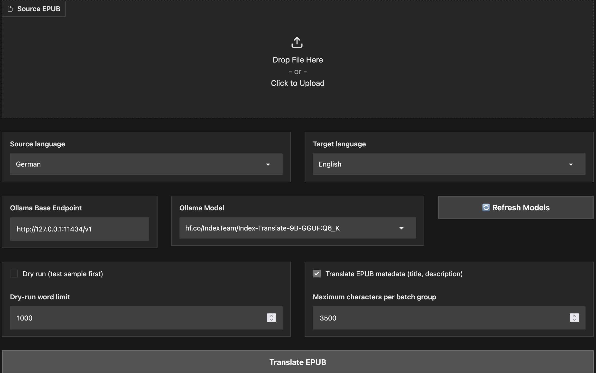

#  Local Structure-Preserving EPUB Language Localization with Ollama

Local Gradio EPUB translator, tested on macOS / Apple Silicon M5 MacBook Pro 24GB Ram

Features:
- preserves EPUB package structure
- modifies XHTML text nodes only
- preserves HTML/XML tags
- groups text across inline tags for better context
- protected `SEG_n` placeholders
- persistent translation cache
- resume after interruption by reusing cached translations
- dry-run / first-N-words mode
- optional EPUB metadata translation
- Ollama-compatible local-server backend

## Setup

```bash
python3.12 -m venv .venv
source .venv/bin/activate
python -m pip install --upgrade pip setuptools wheel
pip install -r requirements.txt
python app.py
```

## Setup Ollama backend
1. Install [Ollama](https://ollama.com/download) local app
2. Download a suitable model
```bash
ollama pull hf.co/IndexTeam/Index-Translate-9B-GGUF:Q6_K
```

## Start
```bash
source .venv/bin/activate
python app.py
```

Open the Gradio URL printed in the terminal.

The Ollama-compatible backend is provided so the EPUB application can
connect to a local inference server exposing the model at:

http://127.0.0.1:11434/v1

The default application starts in dry-run mode. Test a small sample first.

## Warning
It can take tens few hours to translate a moderately sized book.


